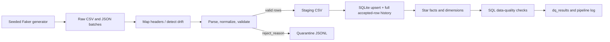

# Apex AI Arabia — Junior Data Engineer 48-hour assessment

A small, local, explainable pipeline for daily synthetic hospital scheduling,
claims, and support files. All patient/provider identifiers and events are
synthetic. Python handles ingestion and validation; SQLite persists the
star-style current-state facts, history, batch ledger, and DQ results.

## Setup and run

Requires Python 3.11 or newer.

```powershell
python -m venv .venv
.\.venv\Scripts\Activate.ps1
python -m pip install -r requirements.txt
python -m src.pipeline
python -m pytest
```

With GNU Make installed, `make run` runs the same pipeline and `make test`
runs pytest. Pipeline generation is deterministic and regenerates the two raw
batches before ingestion. The run prints curated counts and confirms whether
the second delivery of day two left them unchanged. SQLite database:
`data/curated/assessment.db`.

Controlled demonstrations:

```powershell
python -m src.pipeline --schema-drift-demo
python -m src.pipeline --fail-demo
```

Both demos print `EXPECTED CONTROLLED FAILURE` and the diagnostic. They run
against a temporary copy/tree and leave the normal curated database unchanged.
The two distinct investigation paths are in
[docs/failure_runbook.md](docs/failure_runbook.md).

## Dependencies

Python standard library (`sqlite3`, CSV, JSON, logging, hashing) plus pandas for
robust timestamp parsing, PyYAML for config, Faker for synthetic data, and
pytest for tests. No cloud services, Spark, or orchestrator are used.

## Structure

```text
config.yaml                Runtime paths, aliases, accepted statuses, bounds
data/raw/batch_day1|2/     Deterministic synthetic source files
data/staging/              Canonical accepted rows by batch/source
data/quarantine/           Rejected JSONL rows with reject_reason
data/curated/               SQLite star schema and local database
logs/pipeline.log           Run-id-tagged console/file stage logs
src/                        Generator, ingest, transform, DQ, load, runner
sql/schema.sql              Local model and operational tables
sql/analysis.sql            Dashboard, operational, DQ and reconciliation SQL
tests/                      Focused behavior and pipeline tests
docs/                       Issue map, model, dictionary, handoff, disclosure
```

## Pipeline flow



## Model and assumptions

See [docs/diagram.md](docs/diagram.md) and
[docs/data_dictionary.md](docs/data_dictionary.md). The three fact tables have
different grains (one appointment, claim, or support interaction). Shared
synthetic patient/provider dimensions and a date dimension support consistent
analysis without combining unlike facts. The facts keep the latest accepted
row by business key and source `updated_at`; every accepted input version,
including identical duplicates, is retained in `fact_record_history`.

Naive date strings are interpreted as UTC by pandas; offset-aware timestamps
are converted to UTC. Status mappings are explicit in `config.yaml`. Unknown
columns fail fast with a mapping suggestion; recognized aliases (including
the planned day-two rename) are accepted. Invalid records remain in quarantine.
An orphan patient/provider or amount outside configured bounds is quarantined.
Claim-to-appointment is optional and is not an enforced foreign key. Minimum
row expectations apply to final current-state facts; intentional duplicates
and quarantine mean source row totals are expected to differ.

## SQL and quality

`sql/analysis.sql` has seven examples. The final query compares raw-file row
counts from the processed-batch ledger, accepted row history, and current-state
facts; inspect quarantine JSONL for explicit rejected-row counts. DQ results
persist per run in `dq_results` and logs. Checks cover uniqueness, non-null
business keys, accepted statuses, patient/provider/date integrity, timestamps,
amount bounds, history-based duplicate/version audit, and source-specific
minimum current-state counts, repeated-key detection, and completeness of the
accepted-row history. For a successfully mapped file, every row either stages
or has a recorded quarantine reason; accepted duplicate versions remain in
audit history.

## Limitations and production roadmap (not implemented)

This prototype is single-machine, single-process, small-batch, and SQLite-only.
For production, first agree on source contracts and business definitions; then
consider a supported orchestrator (Airflow/Dagster), object storage, a
Postgres/warehouse target, dbt transformations, and Great Expectations or an
equivalent governed DQ framework. Add partitioning, monitoring/alerting,
controlled schema evolution, retries and operational ownership. Real patient
data additionally requires formal PII handling, security/privacy review,
Saudi data-residency and PDPL assessment, retention, access controls, and
encryption. Those roadmap elements are explicitly outside this implementation.

## Live defense: 10-minute walkthrough

1. **0:00–1:00 — Goal:** explain raw daily feeds and why synthetic fixtures make edge cases reproducible.
2. **1:00–2:00 — Generator:** show the fixed seed and `docs/data_issues.md`; point out planted defects and day-two changes.
3. **2:00–3:00 — Config/ingest:** trace a source alias from `config.yaml` through canonical headers; show unknown columns raise `SchemaDriftError`.
4. **3:00–4:00 — Transform:** show status normalization, UTC parsing, and row-level rejection reasons in quarantine.
5. **4:00–5:00 — Model:** explain fact grains, conformed pseudonymous dimensions, and date keys from the Mermaid diagram.
6. **5:00–6:00 — Incrementality:** inspect `processed_batches`, demonstrate hash-based skip and latest `updated_at` upsert; history preserves accepted input.
7. **6:00–7:00 — Quality:** show `dq_results`, a successful run, then `make fail-demo` and the explicit failed check.
8. **7:00–8:00 — Analysis:** run the claim approval/support resolution examples and discuss raw-to-curated reconciliation.
9. **8:00–9:00 — Tests:** run pytest and explain timestamp, status, mapping, upsert/history and config cases.
10. **9:00–10:00 — Boundaries:** state what is synthetic/local only and outline the production roadmap without claiming those pieces exist.

### Defense scenario answers

- **Renamed column + new status:** The configured `scheduled_at` alias maps to the canonical appointment time; `Rescheduled` maps to `rescheduled`. For an unrecognized rename, fail clearly, inspect the exact header, confirm its meaning with the source owner, then add an alias mapping. A genuinely new status needs an explicit normalized value and accepted-value tests.
- **Same batch twice:** The file SHA-256 and batch/source ID are recorded. An unchanged hash skips processing, and business-key upserts are stable. Day two is run twice in the normal command to show unchanged current fact counts. History is not duplicated because unchanged files are skipped.
- **KPI mismatch debugging:** Use the last section of `sql/analysis.sql`, compare raw file counts and accepted history counts, then inspect per-batch quarantine JSONL reasons and DQ log lines. Current-state fact counts are lower than accepted history when business keys have multiple versions; that is intentional.
- **Add a DQ rule live:** Add a named SQL assertion to `run_quality_checks`, persist/log it through the shared result loop, add a focused test with violating and clean data, then rerun tests and the pipeline. Decide whether the rule is hard-fail or warning explicitly.
- **Millions of records/day:** First measure throughput and identify bottlenecks; replace row-at-a-time Python/SQLite writes with set-based staging and batch transactions, then move to partitioned object storage and a properly sized warehouse/database. Add orchestration, backpressure/retries, schema contracts, observability, and data governance based on measured requirements.

## AI/tool disclosure

Fill in [docs/ai_disclosure.md](docs/ai_disclosure.md) honestly before sharing
the assessment. It intentionally contains placeholders rather than claiming
verification you have not personally performed.
