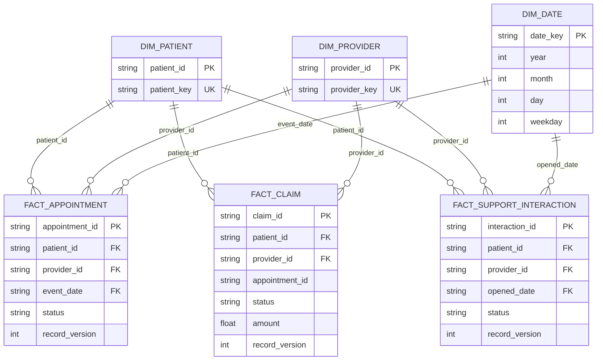

# Star model

The three facts describe separate business processes and therefore retain their
own grains: one appointment, one claim, and one support interaction per row.
Shared pseudonymous patient/provider dimensions allow consistent cross-process
dashboards without inventing a combined fact grain. A date dimension makes time
grouping explicit. `fact_record_history` is an operational audit table rather
than a dashboard fact; it preserves every accepted source version.
